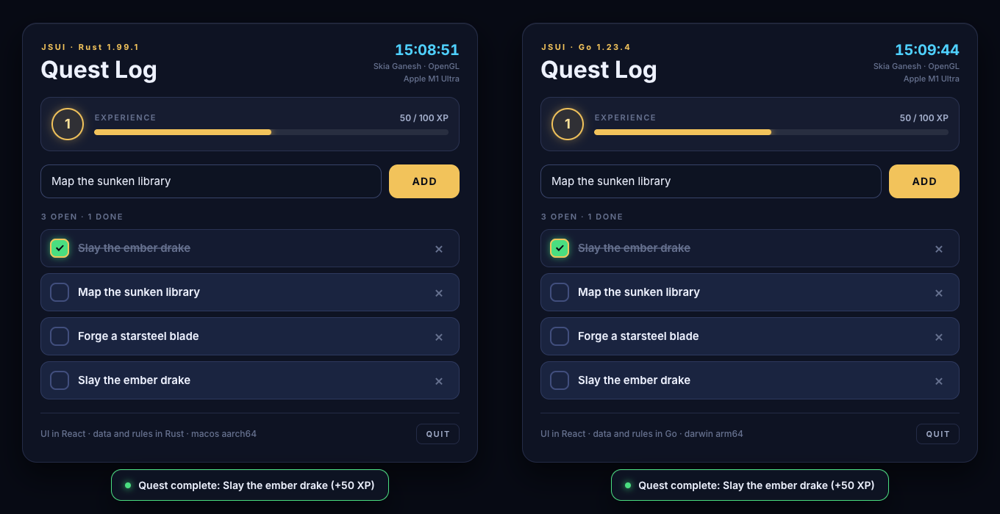

# Language bindings

JSUI is a C library, so any language with a C FFI can host a React UI. These
are thin bindings over [the C API](../include/jsui/jsui.h) plus one example
app, the same in each language:

| Language | Package | Example |
| --- | --- | --- |
| [Rust](rust/README.md) | `jsui` crate (`src/sys.rs` raw declarations, `src/lib.rs` safe wrapper) | `cargo run --release --example quests` |
| [Go](go/README.md) | `github.com/orktes/jsui/bindings/go` (cgo) | `cd go/examples/quests && go run .` |

The example is a quest log ([ui/app.jsx](ui/app.jsx)): a desktop window
(GLFW, OpenGL 3.3 core) where Skia draws the UI on the GPU, straight into the
window's framebuffer. The program owns the data and the rules; the UI only
shows them and asks for changes:

* **Program -> UI shared state** (`jsui_set_state`): `quests`, `player` (XP and
  level, computed by the program), `host` (language, GPU) and `clock`.
  `useHostState(key)` re-renders on change.
* **UI -> program calls** (`Host.call` -> `on_call`): `quests.add`,
  `quests.toggle`, `quests.remove`. The program changes its data, publishes the
  new state and resolves the call.
* **Program -> UI messages** (`jsui_post_message`): a `toast` when a quest is
  completed or the player levels up.
* **Input pass-through**: every event goes to the UI first; what it does not
  consume (`jsui_send_*` returns 0) is the program's.



## Build and run

Both link `libjsui` (`libjsui.so` / `libjsui.dylib`), the shared library with
only the C API exported. Build it from this repository, or take `lib/` from a
release archive (`jsui-shared-<platform>`) and point the binding at it
(`JSUI_LIB_DIR` for Rust, `CGO_LDFLAGS` for Go).

```sh
npm install
npx jsui build bindings/ui/app.jsx -o bindings/ui/dist/bundle.js
cmake -S . -B build -G Ninja -DCMAKE_BUILD_TYPE=Release -DJSUI_BUILD_SHARED=ON \
  -DJSUI_BUILD_TESTS=OFF -DJSUI_BUILD_VIEWER=OFF -DJSUI_BUILD_TOOLS=OFF
cmake --build build --target jsui_shared

cd bindings/rust && cargo run --release --example quests
cd bindings/go/examples/quests && go run .
```

On Linux GLFW needs the X11 and GL development packages (`libx11-dev
libxrandr-dev libxinerama-dev libxcursor-dev libxi-dev libgl1-mesa-dev`).

Both examples take the same options:

| Option | |
| --- | --- |
| `bundle.js` or a URL | the UI to run (default: the bundle built above) |
| `--dev` | the bundle is a `jsui dev` URL: `npx jsui dev bindings/ui/app.jsx`, then `--dev http://127.0.0.1:5173/bundle.js`; edits hot-update in place |
| `--width W --height H` | window size in logical px (default 900 x 760) |
| `--frames N --screenshot out.png` | run N frames, save what the GPU drew, exit |
| `--selftest` | scripted round trip, then exit: a click on empty space must pass through, Add must create a quest in the program, ticking the first quest must give 50 XP and the UI must show it. Prints `selftest: ok`. |

CI builds `libjsui` on Linux and runs both test suites and both self-tests
under Xvfb on Mesa's GL (the `bindings` job in `.github/workflows/ci.yml`).

## Another language

Everything the bindings do is in the C API, so another language follows the
same steps: declare the functions (or generate them from `jsui.h`), pass
callbacks with a `user` pointer that leads back to your runtime object, keep
every call on the thread that ticks the runtime, and move values as JSON text.
