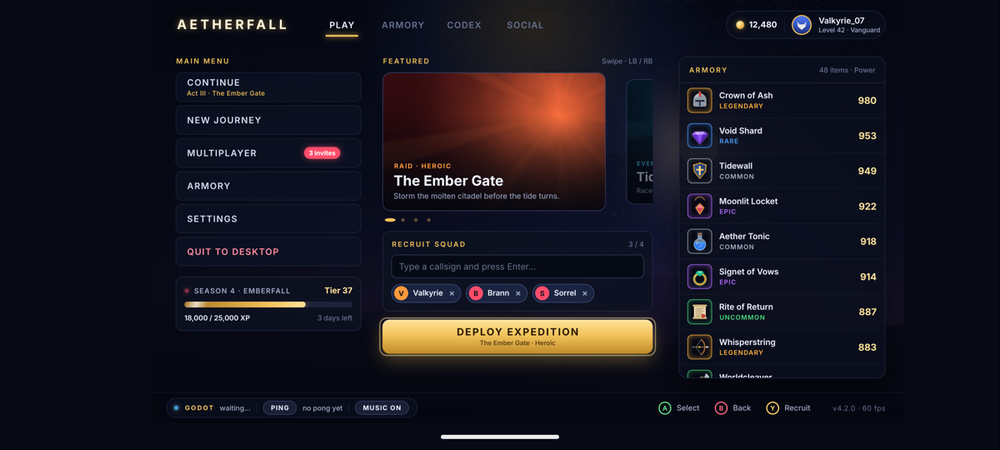

# JSUI on Android



`JsuiDemo` is a minimal NDK host: a `NativeActivity` (no Java code) whose
native library renders a JSUI bundle with Skia **Graphite on Vulkan**. JSUI
repaints only the damage into a retained image of the host's own
(`jsui_render_gpu_target` with `JSUI_GPU_INCREMENTAL`). A small render pass
then draws that image into the swapchain image, pre-rotated to the display's
current transform (so the compositor does not rotate it) and opaque, and
presents it. Devices without Vulkan 1.1, or where any step of the setup
fails, fall back to Skia Ganesh on **OpenGL ES 3** through EGL, straight into
the window surface (`jsui_render_gl_target`, default framebuffer). Without
that either, the CPU rasteriser paints into the window's buffer
(`ANativeWindow_lock`). Frames are paced by `AChoreographer`. The pipeline
caches (Graphite's pipeline list, the Vulkan driver's `VkPipelineCache`
data, Ganesh's shaders) are kept in the app's cache directory
(`jsui_set_cache_dir(Context.getCacheDir())`), so from the second launch on
the pipelines are built before the first frames need them.
It forwards touches (with the historical samples between frames and their
timestamps, for gesture velocities), hardware keys (Back is Escape; unused, it
leaves the app) and gamepads (W3C standard mapping, sticks, hats and
triggers), and publishes the system bar / display cutout insets as the safe
area. Landscape.

## Build and run

Needs the Android SDK (`build-tools`, `platforms;android-35`, `platform-tools`),
an NDK (r30 tested), CMake, Ninja, Node and a JDK (for `keytool`). Works on
macOS and Linux hosts.

```sh
RUN=1 scripts/build-android.sh     # Skia, UI bundle, APK, install + launch + screenshot (adb)
```

* `scripts/build-skia-android.sh` builds Skia (m157, Graphite + Vulkan,
  Ganesh + GL, the Android font manager with bundled FreeType / expat, bundled ICU / HarfBuzz) with the
  NDK into `third_party/skia-android/out/android-<cpu>` (`CPUS=arm64` or `x64`).
* `scripts/build-android.sh` bundles `APP` (default: the Godot demo UI) with
  `jsui build`, builds `libjsuidemo.so` with the NDK's CMake toolchain, and
  packages `build-android/JsuiDemo.apk` with `aapt2` (the bundle under
  `assets/ui/`, read through `AAssetManager` as `asset:///ui/...`), `zipalign`
  (16 KB pages) and `apksigner` (debug key). `ABI=x86_64` builds for Intel
  emulators.

An emulator for it:

```sh
sdkmanager "system-images;android-35;google_apis;arm64-v8a" "emulator"
avdmanager create avd -n jsui_api35 -k "system-images;android-35;google_apis;arm64-v8a" -d pixel_7
emulator -avd jsui_api35 -gpu host -feature Vulkan &
```

On Apple silicon the emulator's Vulkan (gfxstream) runs on MoltenVK. There
JSUI turns Graphite's internal MSAA off: it loaded garbage into the passes
that repaint part of a retained target.

## Live reload

```sh
npx jsui dev integrations/godot/demo/ui/app.jsx --host 0.0.0.0
adb shell am start -n com.orktes.jsui.demo/android.app.NativeActivity --es jsui_url http://10.0.2.2:5173/bundle.js
```

(`10.0.2.2` is the host machine from the emulator; use the computer's LAN
address on a device.) `--es jsui_renderer gl` forces Ganesh on GLES and
`--es jsui_renderer cpu` the CPU path. Every 5 seconds of drawing, logcat
(`adb logcat -s jsui`) gets the frame rate and the mean and longest time of
a frame's render + present. The
bundle's JS runs on a thread of its own, as in React Native, so a long
commit never drops a frame; `--es jsui_js_thread off` runs it on the frame
thread instead.

## Embedding

Link `libjsui.a` (built by this CMake project with the NDK toolchain) and the
Skia libraries. Before creating a GPU context, name the cache directory
(Android has no default one):

```c
jsui_set_cache_dir(cache_dir);  // Context.getCacheDir()
```

On Vulkan (what `main.cpp` does), with a device of Vulkan 1.1 and a
graphics queue:

```c
JsuiVulkanDevice d = {0};
d.instance = instance; d.physical_device = phys; d.device = device;
d.queue = queue; d.queue_family = family;
JsuiGpuContext* gpu = jsui_gpu_create_vulkan(&d);   // NULL: fall back to GLES
...
jsui_tick(rt, now_ms);
if (jsui_needs_redraw(rt)) {
  JsuiGpuTarget t = {0};
  t.texture = frame_image; t.width = w; t.height = h;   // an RGBA8 image the host keeps
  t.flags = frame_valid ? JSUI_GPU_INCREMENTAL : 0;
  t.layout = frame_valid ? VK_IMAGE_LAYOUT_SHADER_READ_ONLY_OPTIMAL : VK_IMAGE_LAYOUT_UNDEFINED;
  t.final_layout = VK_IMAGE_LAYOUT_SHADER_READ_ONLY_OPTIMAL;
  jsui_render_gpu_target(rt, gpu, &t, NULL);   // submitted to `queue` when it returns
  // draw frame_image into the acquired swapchain image, present
}
```

On GLES, per frame on the thread that owns the EGL context:

```c
JsuiGpuContext* gpu = jsui_gpu_create_gl(get_proc, NULL);  // once, with the context current
...
jsui_tick(rt, now_ms);
if (jsui_needs_redraw(rt)) {
  JsuiGLTarget t = {0};
  t.width = w; t.height = h; t.stencil_bits = 8;    // the window surface's config
  jsui_render_gl_target(rt, gpu, &t);
  eglSwapBuffers(display, surface);
}
```

Not yet: the on-screen keyboard for `TextInput` (hardware keyboards work),
audio (bring an `on_audio` handler, e.g. on AAudio /
Oboe), and an Android library package (AAR) for Gradle projects.
