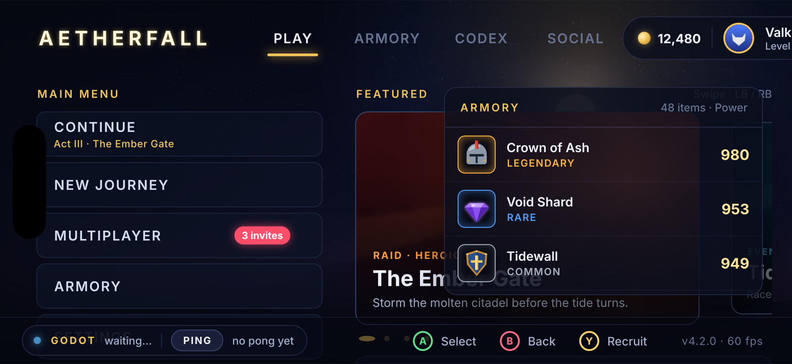

# JSUI on iOS



`JsuiDemo` is a minimal UIKit host: one `MTKView` that renders a JSUI bundle
with Skia Ganesh on **Metal** (`jsui_render_metal`, straight into the
drawable), falling back to the CPU rasteriser plus a blit. It forwards
touches (with coalesced samples and timestamps for gesture velocities),
hardware keyboards and game controllers (GameController.framework, mapped to
the W3C standard gamepad layout). Landscape on phones, any orientation on iPad.

## Build and run (macOS + Xcode)

```sh
brew install ninja cmake
RUN=1 scripts/build-ios.sh          # Skia slice, UI bundle, app, simulator, screenshot
```

* `scripts/build-skia-ios.sh` builds Skia (m157, Ganesh + Metal, CoreText
  fonts, bundled ICU / HarfBuzz) into `third_party/skia-ios/out/<sdk>-<cpu>`
  (`iphoneos-arm64`, `iphonesimulator-arm64`, `iphonesimulator-x64`).
* `scripts/build-ios.sh` bundles `APP` (default: the Godot demo UI) with
  `jsui build`, configures CMake with `CMAKE_SYSTEM_NAME=iOS` and builds
  `build-ios-sim/integrations/ios/JsuiDemo.app`. `SDK=iphoneos` builds for
  devices (sign with `-DJSUI_IOS_TEAM=<team id> -G Xcode` to install).

## Live reload

```sh
npx jsui dev integrations/godot/demo/ui/app.jsx --host 0.0.0.0
xcrun simctl launch booted com.orktes.jsui.demo -JsuiURL http://localhost:5173/bundle.js
```

`-JsuiRenderer cpu` forces the CPU path. The bundle's JS runs on a thread of
its own, as in React Native, so a long commit never drops a frame;
`-JsuiJsThread off` runs it on the main thread instead.

## Embedding

Link `libjsui.a` (built by this CMake project for iOS) and the Skia
libraries, then per frame:

```objc
jsui_tick(rt, CACurrentMediaTime() * 1000);
if (jsui_needs_redraw(rt)) {
  id<CAMetalDrawable> d = layer.nextDrawable;
  jsui_render_metal(rt, mtl, (__bridge void*)d.texture, MTLPixelFormatBGRA8Unorm, w, h, 0);
  id<MTLCommandBuffer> cb = [queue commandBuffer];  // same queue JSUI submits on
  [cb presentDrawable:d];
  [cb commit];
}
```

## Sound, video and startup state

* Sounds (`Sound`, `UISounds`) play with the library's built-in miniaudio
  backend: `scripts/build-ios.sh` configures with `-DJSUI_AUDIO=ON` (iOS
  builds default it off, for embedders with their own audio handler). The
  default audio session follows the ring / silent switch.
* `<Video>` plays with AVFoundation through the desktop viewer's handler
  (`tools/jsui-viewer/video.mm`), straight into the host texture on Metal.
* `STATE='{"key": value}' scripts/build-ios.sh` ships `ui/state.json`, set as
  shared state before the bundle loads (`jsui-viewer --state` on desktop).
  The showcase site, for example:

  ```sh
  SDK=iphoneos APP=site/app/index.jsx \
  STATE='{"intro":{"play":true,"warmup":false},"audio":{"native":true}}' scripts/build-ios.sh
  ```

## Safe area

The host publishes `UIView.safeAreaInsets` as shared state `jsui.safeAreaInsets`
(`{top, right, bottom, left}` in points). `SafeAreaView` and `useSafeAreaInsets()`
(react-native and react-native-safe-area-context) read it, and it is updated on
rotation. Other hosts publish theirs with `jsui_set_safe_area_insets()` (Android
from the system bars and display cutout, the web host from
`env(safe-area-inset-*)`); a host that leaves it unset (a game's UI texture)
gets zero insets. The showcase site uses it for its nav bar, gutters, footer
and full-screen examples.

Not yet: the on-screen keyboard for `TextInput` (hardware keyboards work).
