# jsui-wm: a touch desktop for Linux, drawn by JSUI

An experiment: an X11 window manager and compositor (`jsui-wm`) and a Wayland
compositor (`jsui-wl`, wlroots) whose entire desktop shell is the same React
app running in JSUI. It is made for 11" touchscreens (1920x1200 at
150 %, every control at least 48 logical px) and works mobile first: apps open
full screen down to a home indicator, a swipe up from the bottom edge opens the
card switcher, two apps share the screen in split view.

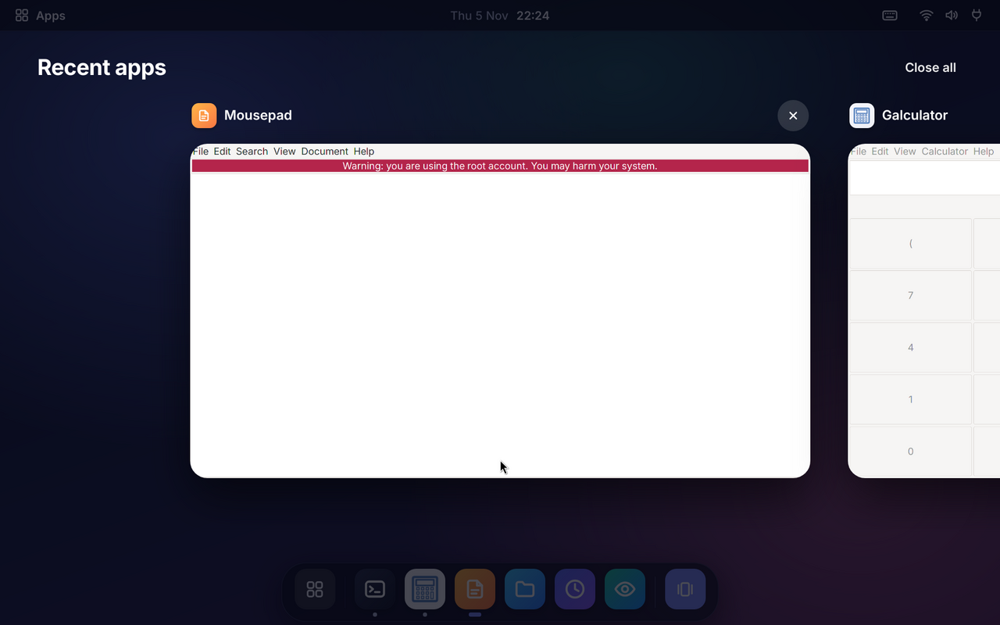

| | |
| --- | --- |
| 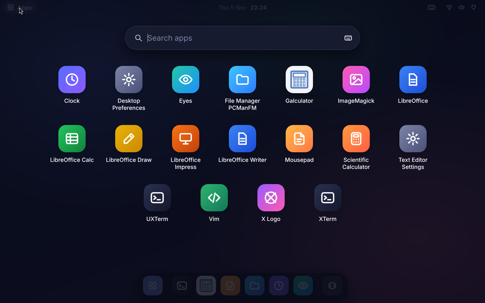 | 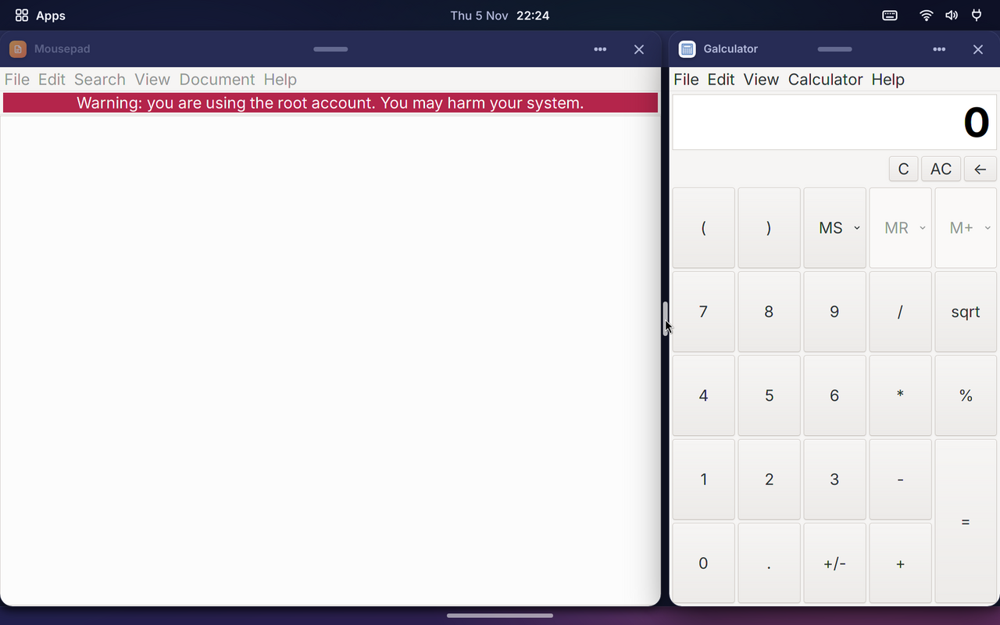 |
| 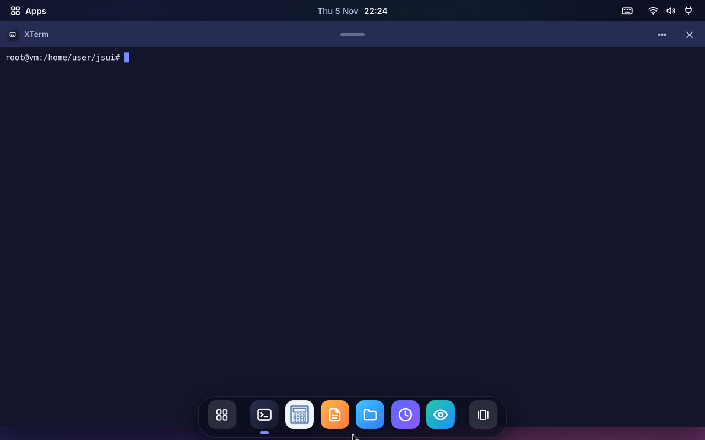 | 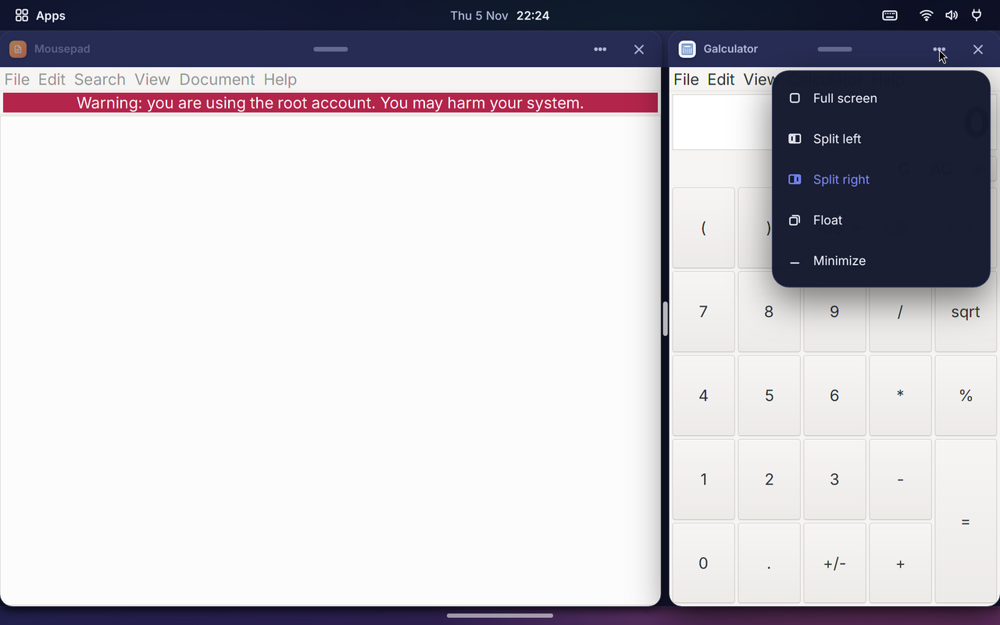 |
| 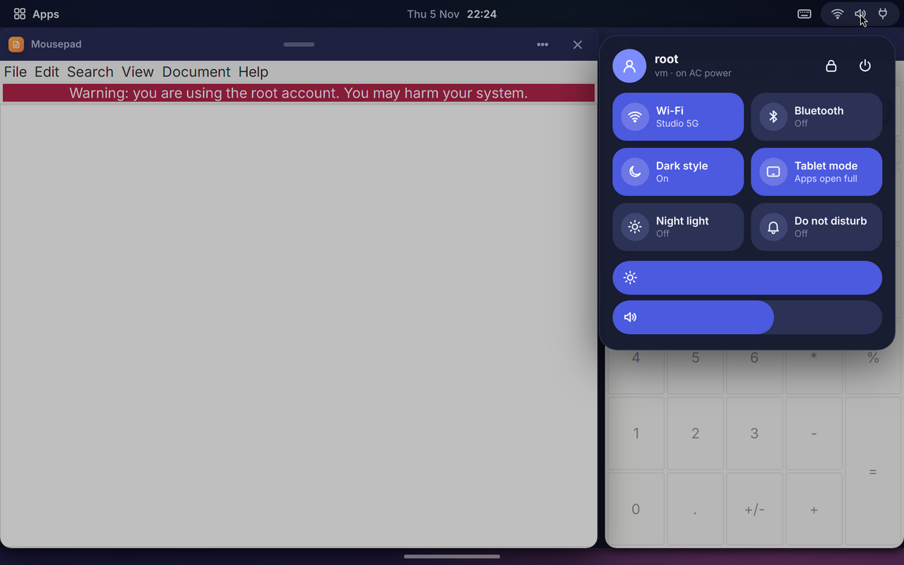 | 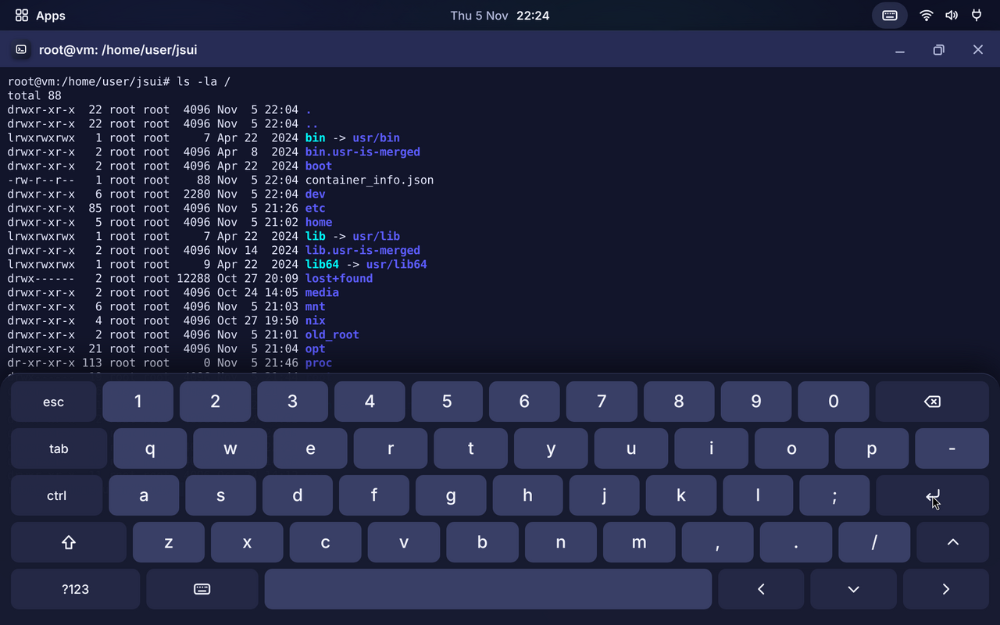 |

## Try it (Docker)

```sh
docker build -f integrations/x11-wm/docker/Dockerfile -t jsui-wm .
docker run --rm -p 5900:5900 jsui-wm                  # then open a VNC viewer on localhost:5900
docker run --rm -v "$PWD/shots:/out" jsui-wm tour     # scripted tour, a screenshot per step in shots/
```

Add `-e WM=wayland` to run the Wayland compositor instead (headless wlroots,
`wayvnc` for VNC, foot as the terminal).

The X11 container runs Xvfb at 1920x1200 (`-e SCREEN=1366x768x24` for another
panel, `-e SCALE=1.25` for another scale), the window manager, and xterm,
Mousepad, Galculator, PCManFM and the classic X apps to open from the
launcher. Xvfb has no GPU, so the shell is rasterised on the CPU; on real
hardware the same host could render with Skia on the GPU.

## What the shell does

* **Apps open full screen** (tablet mode, the default), down to a home
  indicator at the bottom edge: tap it or swipe up a little for the dock. Each
  app gets a slim header with a grabber, its name, a menu (full screen, split
  left / right, float, minimize) and close. Turn tablet mode off in quick
  settings for floating windows and a permanent dock.
* **Card switcher.** Swipe up from the bottom edge (or on the dock, or tap the
  dock's last button, or Alt+Tab): every app as a card, most recent first,
  flung sideways and snapping to the middle card. Tap a card to switch, swipe
  it up to close it, *Split* puts it next to the current app. The current app
  shrinks into its card as the switcher opens, and the picked card grows back
  into its window when it closes.
* **Quick switch.** Swipe sideways along the bottom edge or the dock: left
  jumps to the previous app, right cycles to the oldest.
* **Split view.** Two apps side by side with a divider you drag (25-75 %). Also
  from the app header's menu, by dragging a title bar to a side edge, or
  Super+Left/Right.
* **Floating windows** (tablet mode off): drag the title bar to move, to the top
  edge to maximize, to a side edge to snap; double-tap the title bar to
  maximize; drag a border or corner to resize. Big minimize / maximize / close
  buttons. Windows fade in, minimize into the dock and fade out on close.
* **Dock**: pinned apps, running apps with dot indicators, tap to open /
  switch / minimize, long-press for a menu (new window, the app's windows,
  close).
* **Launcher**: app grid from the `.desktop` files, search (physical or
  on-screen keyboard).
* **Top bar**: apps button, current app, clock (calendar and notifications
  panel; swipe down on the left half), status icons (quick settings; swipe
  down on the right half).
* **Quick settings**: Wi-Fi, Bluetooth, dark / light style, tablet mode, night
  light, do not disturb, brightness and volume sliders, lock, and a power
  sheet (lock, restart shell, log out). Brightness and night light really tint the screen; Wi-Fi /
  Bluetooth / volume are visual only in this prototype.
* **On-screen keyboard** (keyboard icon in the top bar): types into the focused
  app through XTest, or into the launcher's search. One-shot Shift and Ctrl, a
  symbol layer with what a terminal needs.
* **Lock screen**: swipe up to unlock.
* Client-side decorated (GTK headerbar) windows get no frame and can move /
  resize themselves (`_NET_WM_MOVERESIZE`); menus and tooltips
  (override-redirect windows) are composited above everything.

## How it works

`main.cpp` is the host, a few thousand lines over Xlib and the C API:

* **Compositing.** Every top-level window is redirected off screen
  (Composite, manual). On XDamage the host copies the damaged rectangle of the
  window's pixmap (MIT-SHM) into a JSUI host texture `win:<id>`, and the shell
  draws it with `<HostTexture>` inside its own frame. The JSUI frame is
  rendered with `jsui_render_rgba_incremental` and only the dirty rectangle is
  put on the Composite overlay window.
* **Input.** The overlay takes no input, so X still routes input by the real
  window geometry, which the host keeps where the shell draws each window:
  presses on a window's content go straight to the app (a passive grab focuses
  and raises unfocused windows, then replays the click); an InputOnly frame
  window under each title bar and border sends those presses to the shell; one
  InputOnly shell window above every app has the input shape of whatever the
  shell says is on top (`wm:shellRegions`: the bars, open panels, the
  keyboard, the split divider). Presses on the wallpaper go to the shell too.
  Pointer input reaches JSUI as touch (one finger), XInput 2.2 touch events on
  the shell's windows as multi-touch; `--mouse` sends mouse events instead.
* **State.** Shared state the shell reads: `wm.screen` (size, scale, bar
  heights; the work area ends at the home indicator in tablet mode, above the
  dock otherwise), `wm.windows` (id, title, class, app id, geometry in logical px,
  type, minimized / maximized / snap / fullscreen, ready), `wm.stack` (bottom
  to top, so the top is the most recent), `wm.active`, `wm.popups`, `wm.apps`
  (desktop files), `wm.system`. The shell writes `wm.settings`.
* **Messages from the shell**: `wm:focus`, `wm:move`, `wm:resize`, `wm:close`,
  `wm:closeAll`, `wm:minimize`, `wm:restore`, `wm:maximize`, `wm:snap`,
  `wm:split`, `wm:splitRatio`, `wm:fullscreen`, `wm:launch`, `wm:typeKey`,
  `wm:keyboard` (grab the keyboard for the shell's text field),
  `wm:shellRegions`, `wm:release` (a close animation is done with the last
  frame), `wm:anchors`, `wm:quit`. The host sends `wm:hotkey` (Super, Alt+Tab).
* **EWMH / ICCCM**: `_NET_SUPPORTED`, client lists, active window, frame
  extents, work area, `_NET_WM_STATE` (fullscreen, maximized, hidden),
  window types, `_NET_WM_ICON`, `_NET_WM_MOVERESIZE`, `WM_DELETE_WINDOW`,
  `WM_TAKE_FOCUS`, `WM_STATE`, transient dialogs centred on their parent.

### Wayland (`wayland/main.cpp`)

| | |
|---|---|
| 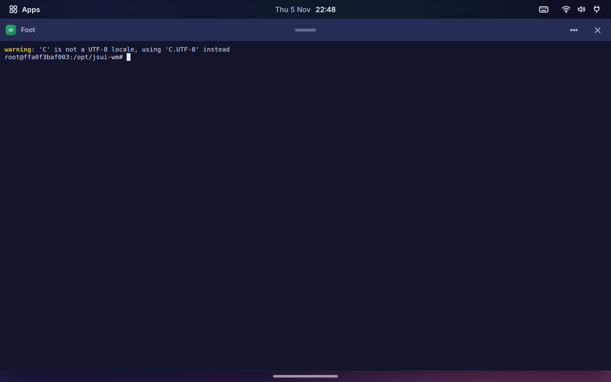 | 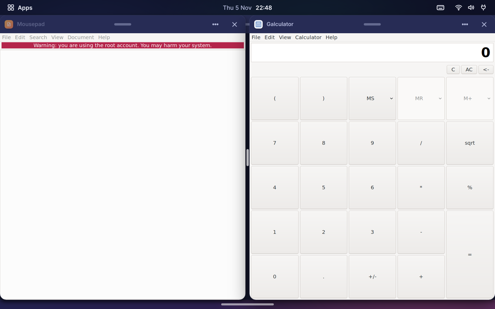 |
| 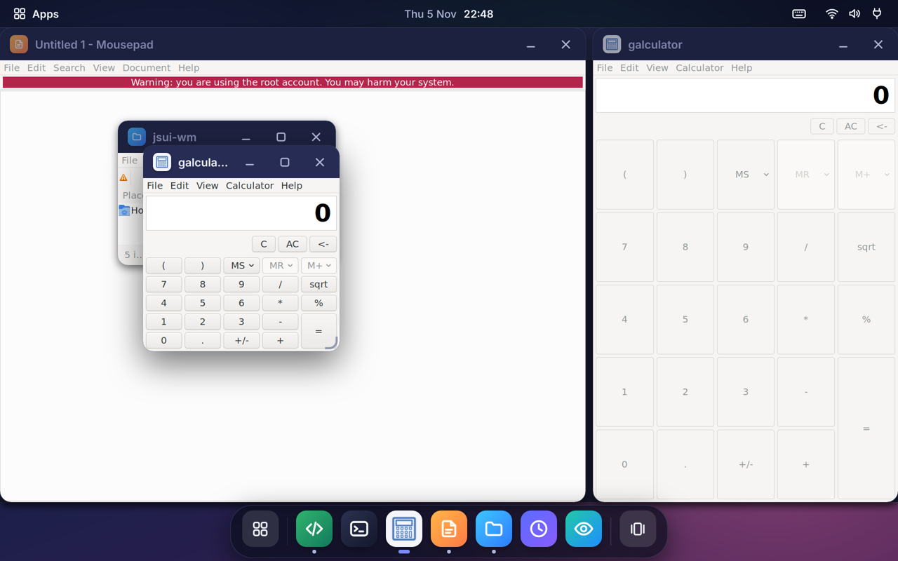 | 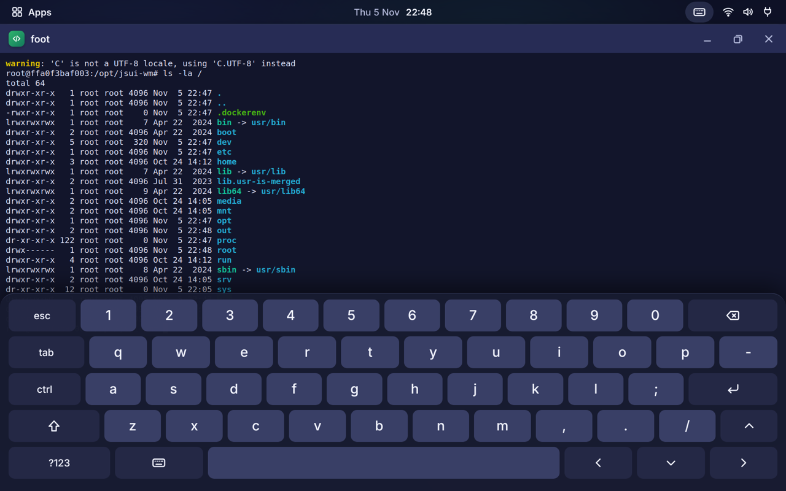 |

`jsui-wl` is a wlroots 0.17 compositor with the same protocol to the shell, so
`ui/` runs unchanged:

* **Output.** One output (the headless backend in Docker, DRM + libinput on a
  device). The scene holds a single buffer, the shell's frame, which JSUI
  renders into directly.
* **Clients.** On every commit of an xdg toplevel the host composites its
  surface tree (subsurfaces included, cropped to the xdg geometry) into
  `win:<id>`; xdg popups are `wm.popups`. Server-side decorations are
  requested (xdg-decoration, and KDE server-decoration for GTK 3), so the shell
  draws every title bar.
* **Input.** The compositor routes each press itself: to the shell (its
  regions, title bars, borders, the wallpaper) or to the client surface below,
  focusing it first. Touchscreen input is multi-touch for the shell and
  `wl_touch` for apps. The on-screen keyboard types through a virtual
  keyboard.
* `--control <socket>` takes `down X Y`, `move X Y`, `up`, `key NAME`,
  `text UTF8`, `touch ID PHASE X Y` (0 down, 1 move, 2 up) and `shot FILE.ppm`
  for test drivers (`tour.py --wayland`).
  wlr-screencopy, xdg-output and the virtual pointer and keyboard protocols are
  there too, so `grim` and `wayvnc` work.
* The shell's React runs on a JS thread of its own, so input, animations and
  paint don't wait for it (`JSUI_WL_JS_THREAD=0`: inside the tick), and the
  bundle is QuickJS bytecode with its source as the fallback (`jsui build`'s
  default).

### Ubuntu Touch (`jsui-wl --mir`, `ubuntu-touch/`)

On Ubuntu Touch the screen belongs to `lomiri-system-compositor` (Mir 1.8 on
Android's hwcomposer through libhybris), and Lomiri is a nested Mir server
that `lomiri-systemd-wrapper` starts as `${LOMIRI_BINARY:-lomiri}`. `jsui-wl
--mir` takes Lomiri's place: wlroots runs headless and still serves Wayland
to the apps, and the shell (which already holds every window) is drawn into a
fullscreen window of the system compositor, opened with mirclient as session
`$MIR_SERVER_NAME` on `$MIR_SERVER_HOST_SOCKET` (`wayland/mir_host.h`). That
window is a GPU window by default: Mir's android2 client platform hands out an
`ANativeWindow`, which libhybris' `null` EGL platform passes to the Android
GLES driver, so Skia (Ganesh) draws the desktop into a texture (only the
damage is repainted) and one textured quad puts it on the panel, rotated.
The swap returns only once the GPU has run the frame, so a present thread
does the quad and the swap in the window's context while the main thread
paints the next frame in a second context sharing the texture (GLES 3 fences
order the two on the GPU; `JSUI_WL_GPU_THREAD=0` keeps it all on the main
thread). In the Tab A7's launcher/switcher bench that takes the main
thread's frame from ~44 ms to ~20 ms, with the GPU (~21 ms) setting the
pace.
If EGL or Skia's GL context fail, or with `JSUI_WL_GPU=0`, the CPU frame is
copied into a software window instead. On the Tab A7 a frame takes ~22 ms on
the GPU against ~91 ms on the CPU (`JSUI_WL_PERF=1` logs paint/present time,
the GPU frame's render/blit/swap split, `jsui_tick` time, JSUI's own
per-phase profile and its paint stats (pixels repainted, draws, offscreen and
cached layers) every 60 frames; `JSUI_WL_GPU_FINISH=1` waits for the GPU
before the swap, so the blit time holds the frame's GPU work and the swap
only the wait for a buffer; `JSUI_WL_GPU_DEBUG=1|2` logs the first presents /
draws a solid quad). With `JSUI_WL_VULKAN=1` the desktop is drawn with Skia
Graphite on Vulkan instead (`wayland/mir_vulkan.h`): libhybris' libvulkan
runs the vendor driver, its `null` platform takes Mir's `ANativeWindow` as a
`VK_KHR_android_surface`, and a present pass draws the retained frame into the
panel's swapchain, rotated (the Android host's design, two frames in flight).
On the Tab A7's Adreno 610 Graphite records a frame in about half Ganesh's CPU
time but its GPU work takes about twice as long (~64 ms frames against ~44 ms
in the launcher/switcher bench), and apps' GPU buffers aren't imported into
Vulkan yet (apps fall back to llvmpipe), so GL stays the default. Touch, pointer and key events of that window come
back on Mir's thread and are queued for the Wayland loop. It is built when
`mir1client` (UBports) or `mirclient` is found. `--rotate 90|180|270`
turns the desktop on the panel (the Tab A7's panel is 1200x2000 portrait;
`jsui-session` uses 90, `JSUI_WM_ROTATE` overrides it) and maps touches
back. `jsui-wl` also runs nested in
any Wayland compositor (`WLR_BACKENDS=wayland`) and follows the size the host
gives it.

* `ubuntu-touch/Dockerfile` builds the arm64 package: `jsui-wl`, the shell,
  wlroots 0.17 and the few libraries the Ubuntu Touch image lacks, and foot.
* `ubuntu-touch/install.sh` (on the tablet, as `phablet`) unpacks it to
  `~/jsui-wm` and adds systemd user drop-ins for `lomiri-full-shell.service`
  and `lomiri-full-greeter.service` (the first-run wizard) that set `LOMIRI_BINARY=~/jsui-wm/jsui-session`. Nothing outside the home
  directory changes; `uninstall.sh` removes the drop-in. `jsui-session` goes
  back to Lomiri by itself after three failed starts within two minutes (a
  `systemctl --user restart` doesn't count). It also switches the Himax
  touch controller's smart wake on. `install.sh --system` (sudo) adds what
  Lomiri normally sets up outside the session: a logind drop-in so the power
  key only toggles the screen (repowerd) instead of powering off, and on the
  Tab A7 `jsui-wm-tap-to-wake.service`, which sends Samsung's `aot_enable,1`
  so a double tap wakes the screen.
* `ubuntu-touch/test/` runs `--mir` without a tablet: `mir-test-server` is a
  Mir 1.8 server on Mir's stub graphics and input platforms with a fake
  touchscreen, and `test-mir.sh` checks that a Mir touch opens the launcher
  and an app opens.

```sh
docker build -f integrations/x11-wm/ubuntu-touch/test/Dockerfile -t jsui-wl-mir .
docker run --rm -v "$PWD/shots:/out" jsui-wl-mir
docker build --platform linux/arm64 -f integrations/x11-wm/ubuntu-touch/Dockerfile --output type=local,dest=out/ .
```

The shell is `ui/` (`shell.jsx` root, `Window.jsx` frames, `bars.jsx` top bar
and dock, `panels.jsx` launcher / switcher / panels / lock screen,
`keyboard.jsx`, `wm.js` the protocol).

## Build it yourself

```sh
sudo apt install libx11-dev libxcomposite-dev libxdamage-dev libxfixes-dev libxext-dev libxtst-dev libxi-dev
npx jsui build integrations/x11-wm/ui/shell.jsx -o integrations/x11-wm/ui/dist/shell.js
cmake -S . -B build -DJSUI_BUILD_X11WM=ON && cmake --build build --target jsui-wm
Xvfb :1 -screen 0 1920x1200x24 & DISPLAY=:1 ./build/jsui-wm
```

Wayland (`sudo apt install libwlroots-dev wayland-protocols libxkbcommon-dev libpixman-1-dev libdrm-dev foot`):

```sh
cmake -S . -B build -DJSUI_BUILD_WAYLAND_WM=ON && cmake --build build --target jsui-wl
WLR_BACKENDS=headless WLR_RENDERER=pixman ./build/jsui-wl --control /tmp/jsui-wl.ctl   # no screen
./build/jsui-wl                                                                         # from a TTY: DRM + libinput
```

`--dev http://127.0.0.1:5173/bundle.js` with `npx jsui dev integrations/x11-wm/ui/shell.jsx`
hot-reloads the shell. `--anchors file.json` writes where named shell elements
are (screen px), which `docker/tour.py` uses to drive it with xdotool.

## Limits of the prototype

* Wayland: no Xwayland yet (X11-only apps such as xterm and xclock don't run
  under `jsui-wl`), no fractional scaling (apps render at scale 1, GTK text is
  scaled with `GDK_DPI_SCALE`), client buffers are read on the CPU (pixman).
* Ubuntu Touch: apps draw on the GPU through libhybris' EGL and hand
  jsui-wl Android gralloc buffers (`android_wlegl`, served by libhybris once
  jsui-wl calls `eglBindWaylandDisplayWL`; `wayland/wlegl.h`). Each buffer
  becomes a GL texture that JSUI samples as the window's host texture, with no
  copy. Subsurfaces of such windows aren't composited. When the shell itself
  is on the CPU, apps get Mesa's llvmpipe instead (`--app-env-nogpu`, see
  `jsui-session`) and hand over shm buffers; Lomiri apps then start in ~1.5 s
  and redraw in ~100 ms. The Tab A7's kernel panics on Bluetooth sockets, so
  apps get `jsui-no-bluetooth.so` preloaded. Lomiri's
  lock screen, indicators, notifications and Maliit keyboard
  aren't there (the shell has its own keyboard). Bringing the port up on the
  stock Samsung vendor took device-side fixes outside this repository (see the
  project notes); adb over USB (usb-moded `mtp_adb`) helps while debugging.
* CPU compositing: each damaged window area is copied through shared memory.
  Fine for Xvfb and a tablet's worth of apps; a real device should import
  window pixmaps as GPU textures.
* Real multi-touch hardware is untested (Xvfb has no touch device); the
  XInput 2.2 path is written but only the pointer path ran here.
* One screen, no workspaces, no notification daemon (D-Bus), no real Wi-Fi /
  audio / battery controls beyond reading `/sys/class/power_supply`.
